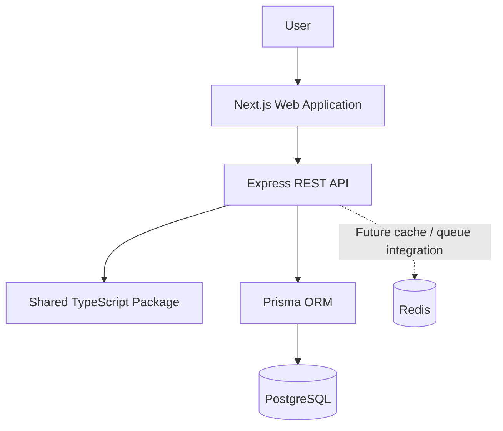

# PulseWatch

**Website and API Monitoring Platform**

PulseWatch is a monitoring platform designed to help developers track website and API availability, identify service interruptions, and understand application health from a centralized dashboard.

The project is being developed as a production-oriented full-stack application, with a focus on backend engineering, API design, database architecture, and reliable monitoring workflows.

> **Development status:** Active development. The foundational project structure and local infrastructure are being developed. Features listed as planned are not yet represented as completed functionality.

---

## Overview

Modern applications depend on reliable websites and APIs. Even short periods of downtime can affect users and business operations.

PulseWatch aims to provide a centralized way to:

- Register websites and API endpoints for monitoring.
- Perform scheduled health checks.
- Record response times and availability history.
- Detect downtime and track incidents.
- Present monitoring information through a web dashboard.
- Publish service health through public status pages.

The long-term goal is to build a maintainable monitoring system with clear separation between the frontend, backend, and data layer.

## Features

### Foundation

- Monorepo architecture using npm workspaces.
- Separate frontend and backend applications.
- Shared TypeScript package.
- Express API application.
- PostgreSQL database infrastructure.
- Prisma ORM schema and migration setup.
- Docker Compose development infrastructure.
- Environment-based configuration and validation.

### Planned functionality

- Website and API endpoint registration.
- Scheduled uptime checks.
- HTTP status and response-time tracking.
- UP, DOWN, and UNKNOWN monitor states.
- Incident creation and resolution.
- Monitoring history and analytics.
- Email notifications.
- Public status pages.
- Dashboard for managing monitors.

Features will be marked as completed here as they are implemented and verified.

## Technology Stack

| Layer                   | Technology                      |
| ----------------------- | ------------------------------- |
| Frontend                | Next.js, React, TypeScript      |
| Backend                 | Node.js, Express.js, TypeScript |
| Database                | PostgreSQL 17                   |
| ORM                     | Prisma 7                        |
| Cache / infrastructure  | Redis 7                         |
| Validation              | Zod                             |
| Development environment | Docker Compose                  |
| Package management      | npm workspaces                  |
| Version control         | Git and GitHub                  |

## Architecture

PulseWatch follows a modular monorepo architecture.



### Repository structure

```text
pulsewatch/
├── apps/
│   ├── api/                 # Express backend
│   │   ├── prisma/          # Prisma schema and migrations
│   │   └── src/             # API source code
│   │
│   └── web/                 # Next.js frontend
│       └── src/
│           └── app/
│
├── packages/
│   └── shared/              # Shared TypeScript code
│
├── docker-compose.yml       # PostgreSQL and Redis
├── .env.example             # Environment template
├── package.json             # Workspace configuration
└── README.md
```

## Getting Started

### Prerequisites

Install the following before running the project:

- Node.js 22 or compatible version
- npm
- Docker Desktop or OrbStack
- Git

### 1. Clone the repository

```bash
git clone https://github.com/umeshkumar-git/pulsewatch.git
cd pulsewatch
```

### 2. Install dependencies

```bash
npm install
```

### 3. Configure environment variables

Create your local environment file:

```bash
cp .env.example .env
```

Update `.env` with your local configuration.

The application requires these environment variables:

| Variable       | Purpose                      |
| -------------- | ---------------------------- |
| `NODE_ENV`     | Application environment      |
| `PORT`         | Backend API port             |
| `WEB_URL`      | Frontend application URL     |
| `DATABASE_URL` | PostgreSQL connection string |
| `REDIS_URL`    | Redis connection string      |

Never commit your actual `.env` file or credentials.

### 4. Start infrastructure

```bash
docker compose up -d
```

Check container status:

```bash
docker compose ps
```

### 5. Apply database migrations

```bash
cd apps/api
npx prisma migrate dev --name init --config prisma.config.ts
npx prisma generate --config prisma.config.ts
```

Return to the project root:

```bash
cd ../..
```

### 6. Start the applications

```bash
npm run dev
```

The frontend and backend development servers are started through the root workspace script.

Check the configured ports in your local environment. The API health endpoint is:

```text
http://localhost:PORT/api/v1/health
```

Replace `PORT` with your configured API port.

## API Documentation

PulseWatch exposes a versioned REST API under:

```text
/api/v1
```

### Current health-check endpoint

| Method | Endpoint         | Purpose                  |
| ------ | ---------------- | ------------------------ |
| GET    | `/api/v1/health` | Check API service health |

Example request:

```bash
curl -i http://localhost:5001/api/v1/health
```

Use the port configured in your `.env` file. The example above assumes port `5001`.

### Planned API modules

| Module         | Responsibility                          |
| -------------- | --------------------------------------- |
| Authentication | User registration and login             |
| Monitors       | Create and manage monitored endpoints   |
| Checks         | Store and retrieve health-check results |
| Incidents      | Track downtime and recovery             |
| Status Pages   | Publish service availability            |
| Notifications  | Manage alert delivery                   |

Detailed request and response documentation will be added as these API modules are implemented.

## Screenshots

Screenshots will be added as the frontend dashboard and monitoring workflows become available.

Planned screenshots:

- Dashboard overview
- Monitor management
- Monitor details and response-time history
- Incident management
- Public status page

Place verified screenshots in the `docs/screenshots/` directory and embed them here.

## Development Status

PulseWatch is currently under active development.

| Component                 | Status             |
| ------------------------- | ------------------ |
| Monorepo setup            | Foundation created |
| Frontend application      | Foundation created |
| Backend API               | Foundation created |
| Shared package            | Foundation created |
| PostgreSQL infrastructure | Configured         |
| Redis infrastructure      | Configured         |
| Prisma data model         | In development     |
| Monitoring engine         | Planned            |
| Scheduled health checks   | Planned            |
| Incident detection        | Planned            |
| Notification system       | Planned            |
| Analytics dashboard       | Planned            |
| Public status pages       | Planned            |

This table will be updated as features are implemented and tested.

## Development Commands

Run these commands from the repository root:

```bash
# Start frontend and backend
npm run dev

# Start only frontend
npm run dev:web

# Start only backend
npm run dev:api

# TypeScript checks
npm run typecheck

# Build project
npm run build
```

## Contributing

This project is currently being developed independently. Suggestions, bug reports, and feedback are welcome through GitHub Issues.

## License

This project is licensed under the MIT License. See the [LICENSE](LICENSE) file for details.

---

**Built with TypeScript, Node.js, Next.js, Express, PostgreSQL, and Prisma.**
